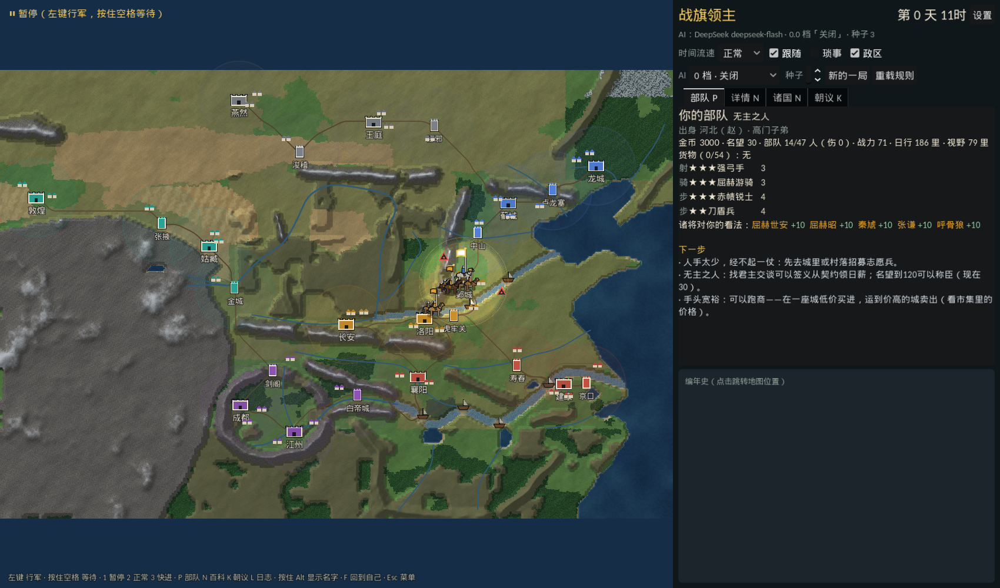

# 流民帅：南北朝

一个 **AI 原生**的类骑马与砍杀战略沙盒，背景是**以南北朝为原型的架空乱世**：周室南渡，周、燕、赵、凉、蜀、柔六国并立，
坞堡林立，流民遍野（世界观见 [docs/worldbuilding.md](docs/worldbuilding.md)）。你选择出身与家世，带着一支小队伍闯荡：
剿匪、跑商、当义从、向君主称臣、攻城略地。将军、商队、村民、匪寇、游侠和义从各自行动；将军由 LLM（DeepSeek / OpenAI / Claude）
或规则 AI 扮演——他们在朝议上建言、表态、宣战议和、分封、倒戈，你也可以和他们交谈（半文半白）。
**默认完全离线**：规则 AI + 预先写好的台词与剧情数据（`server/content/`）。这些内容是开发时用 LLM 写、再经 LLM 审稿和人工审阅的；
直连 LLM 的档位作为可选项保留。
大地图参考中国的真实地理：河西走廊、漠北草原、关中、中原、河北、巴蜀盆地、江南，黄河与长江只能从渡口过，
秦岭、太行、燕山只能走关隘。游戏规则、数值平衡、将军的行事准则、山川格局和 AI 参与程度都写在结构化文档里。



## 快速开始

需要 Python 3.11+ 和 Godot 4.7。

```bash
cd server && uv venv && uv pip install -e '.[llm]'     # LLM 依赖（只玩规则 AI 可跳过）
cd ../client && ./play.sh                               # 启动服务器 + 客户端
```

LLM 的 API key 不进仓库：在 `server/local.toml`（已被 git 忽略）里写 key 文件路径，或设置环境变量：

```toml
# server/local.toml
[llm]
provider = "deepseek"
model = "deepseek-flash"
key_file = "/path/to/your/key.txt"
```

`TIER=0 ./play.sh` 只用规则 AI；游戏里也可以随时切换 AI 档位。

## 怎么玩

- **开局**：像骑砍一样先选**出身地区**（江左 / 辽东 / 河北 / 河西 / 巴蜀 / 漠北），再选**家世**
  （流民帅 / 寒门武人 / 高门子弟 / 部族勇士 / 商贾之家），决定起点、兵种、钱、名望与门第。
- **时间**：像骑砍一样，只有在你行军、或按住**空格**等待时，时间才会流逝；其余时候自动暂停。
- **行军**：左键点击地面前往；点击城镇/村庄/匪巢前往该处；点击部队则追击/前往会面。Shift+左键只查看不移动。
- **进城**：招募志愿兵、在市集买卖货物（低买高卖）、出售俘虏、拜见城中将军、进城休整（按住空格）。
- **部队整训**：士兵靠战斗和日常操练积累经验。按 **U**，选择兵种晋升路线，可以单个或批量晋升。
- **角色成长**（按 **C**）：打仗、办差、比武得经验，升级后分配属性点和技能点；14 项技能里战术、寻路、侦察、医术、疗伤是队伍技能，
  亲自上阵打中敌人会提高武器熟练度。数值在 `server/rules/character.toml`。
- **装备**（按 **I**）：仿战团的物品栏，拖动换装；城里的兵器铺买卖兵器、甲胄、马匹，打了胜仗会缴获。
- **同伴**：8 个原创人物散在各城酒肆，招募后随你上阵（只会被打倒）、分享经验、各自加点换装、提供队伍技能、领日薪；
  各有喜恶和宿敌，士气太低会离队；入队几天后会提出自己的心愿（个人差事）。
- **存档**（按 **F5**）：每 3 天自动存档，另有 5 个存档位。
- **遭遇**：追上别人可以进攻/交谈/离开；被人截住可以迎战、设法脱身、向匪寇破财消灾或投降。战败会被俘，几天后逃脱。
  打仗可以**亲自上阵**（进入 3D 战场，仿战团的方向性近战、骑射、指挥部下）或**让部下打**（自动结算）；匪巢也能亲自带精兵突入。
  设置里有战团式的难度选项（你/友军受到的伤害、战斗 AI、战斗速度、自动格挡/出招、战场规模）和音效音量。
- **差事**：进城向城主打听差事——剿灭匪巢、追剿匪帮、送信、运送物资，办成了得赏金、名望和城主的器重（战团式起家）。
- **出路**：找君主交谈，签义从契约领日薪（君主行踪天下皆知）；名望足够后称臣、拜官受职。之后本国召集军团时会派人召你，
  **应召随军**——一路跟着统帅，他围城时你自动加入，城破即为攻城功臣，攻下后可当面请封。称臣时君主会赐一个村子作**食邑**
  （每天交租）。成长节奏的试玩记录见 [docs/playtest.md](docs/playtest.md)。
- **攻守城战**：云梯造好后可以亲自率军登城。敌军强攻你驻守的己方城池时，可以亲自登墙或让部下守城。
- **进城、进村走走**：城镇、城堡、村庄都可以进 3D 场景里走动，市令、募兵的伍长、擂台主各在其位，守将在府衙大堂、店家和掮客在酒肆里；走过去按 F，对话、接差事、招募、买卖都在 3D 场景里直接进行；酒客会讲最近的传闻。大地图也能放得更近了。
- **擂台比武**：城里可以上擂台（3D 一对一，木兵器），可以下注；连赢下去对手越来越强。
- **封地事务**：在自己的城里留兵守城或抽调守军、加固城墙、开仓赈济（民心太低会叛乱）；食邑可以修渠垦田。
- **小事件**：流民来投、逃兵、营中疫病、城主设宴、名士来投、寺僧化缘、路遇伤兵、山贼投诚、坞堡犒军、欠饷、同乡投军……
  每件都有几个选择（`server/content/events.toml`）。
- **视野**：只有你视野圈内的部队会显示（白天约 70 里，入夜缩到一半，骑兵多、名望高看得更远）；
  城池村落一直在图上，但走近才看得清城防和城中驻军；匪巢要斥候发现后才会出现在地图上。AI 将军也受同样的视野限制，夜里可以偷袭。
- **门第**：分封时各国看重门第的程度不同——周最讲究（寒门不能受封「城」，只能守关塞），燕和蜀几乎不问出身。
- **俘虏敌将**：你亲手打败的将军归你处置——招降（替你效力的国家）、当场索赎、无条件释放，或斩首（掉声望、涨「威名」，
  其国与同族记恨你；斩了君主会引发继承）。不处置的话几天后对方会来赎人；进城可以随时提审。AI 国家也会招降俘虏。
- **流民**：村庄被劫掠后，逃难的村民会扶老携幼往本国城池去（路上会被匪寇盯上）。追上去可以花粮食（或钱）收编为新兵，
  有封地的话也可以指引他们去你的封地安家，增加繁荣和声望。
- **对话**：战团式的话题——问局势、问他听没听说过你、问他对君主的看法、讨差事、恭维、打听某人下落。将军按国家口吻、
  性格、门第、处境和对你的好感作答（台词库约 1000 句，`server/content/dialogue_*.toml`）。开了 LLM 档位后还可以随意打字。

## AI 档位（`server/rules/ai.toml`）

| 档 | 名称 | 由 LLM 决定 |
|---|---|---|
| 0 | 关闭（默认） | 无，全部规则 AI 与预先写好的内容，不需要 API key |
| 1 | 议会 | 君主裁决、和约回应、议会提案、与你对话 |
| 2 | 君主 | + 议会投票、君主/军团统帅的战略 |
| 3 | 全体领主 | + 所有将军的战略 |
| 4 | 全开 | + 更频繁地重新思考 |

LLM 调用是异步的：将军思考时游戏照常进行；失败自动退回规则 AI。
内容的写作流程（LLM 起草 → LLM 审稿 → 人工审阅 → 入库）见 [server/content/README.md](server/content/README.md)。

## 目录

| 目录 | 内容 |
|---|---|
| [`server/`](server/README.md) | Python 模拟服务器：地图生成、行军、战斗、经济、政治、玩家、AI 路由、HTTP 接口 |
| [`server/rules/`](server/rules) | 规则即文档：`balance.toml` 数值、`doctrine.toml` 领主准则、`ai.toml` AI 档位、`units.toml` 兵种货物地形、`world.toml` 王国、城池与领主、`geography.toml` 山川格局 |
| [`client/`](client/README.md) | Godot 4 客户端：大地图、菜单、交易、对话、部队/详情/诸国/议会面板、编年史与战报 |
| [`client/battle/`](client/battle/README.md) | 3D 野战（仿骑砍战团）：遭遇战时「亲自上阵」进入；规则在 `server/rules/battle.toml` |

（`client/docs/.gdignore` 是 Godot 的标记文件——让 Godot 不把文档截图当作游戏资源导入，不是 .gitignore。）

## 路线图

1. ✅ 规则即文档；LLM 领主为主；AI 档位
2. ✅ 玩家：行军、城镇菜单、交易、遭遇战、俘虏、佣兵与封臣、和领主自由对话
3. ⏳ 领主之间自由谈判与密谋；君主主动招揽玩家
4. ⏳ AI 生成内容：编年史、传闻、领主生平、新世界
5. ✅ 部队整训与兵种晋升、角色成长（属性、技能、熟练度）、具名同伴、存档读档、装备与兵器铺
6. ⏳ 自建势力（称王、招揽臣属、联姻宴会）、按兵种预先分队与阵形。与战团的逐项对照见[功能对照](docs/warband-comparison.md)。
