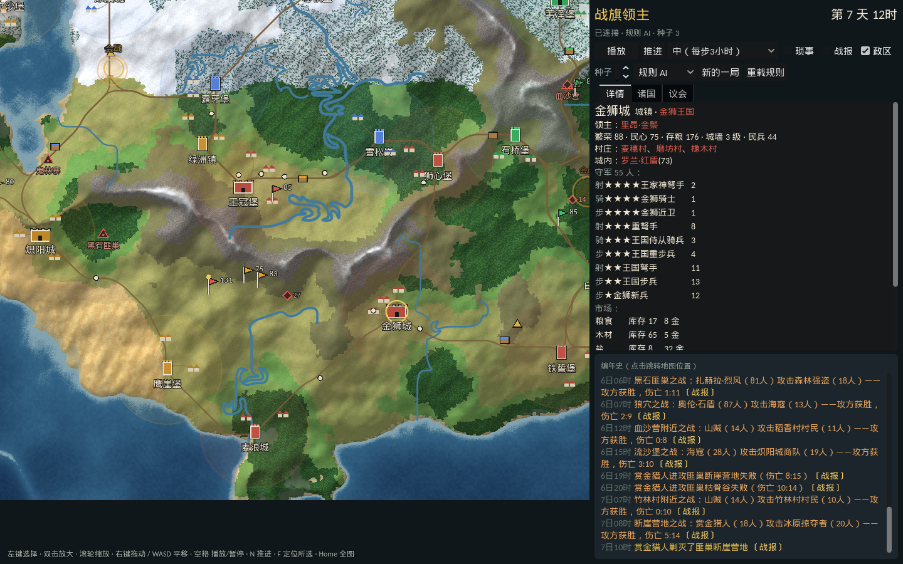

# 流民帅：南北朝（Godot 客户端 v2）

类骑砍战略层沙盒的可视化前端。所有规则与 AI 都在 Python 模拟服务器（`../server`），
本项目只负责显示与操作。




## 启动

```bash
./play.sh                    # 自动启动服务器 + 客户端（AI 档位取 server/rules/ai.toml）
TIER=0 ./play.sh             # 只用规则 AI
SEED=7 TIER=2 ./play.sh      # 换地图、换档位
```

## 操作（仿骑马与砍杀：战团的时间规则 + 霸主的快捷键）

| 按键 | 说明 |
|---|---|
| 左键 | 点击地面：行军到该处；点击城镇/村庄/匪巢：前往；点击部队：追击/前往会面 |
| Shift+左键 | 只查看，不移动 |
| 按住空格 | 原地等待/扎营，时间流逝（战团）。时间只在行军或按住空格时流逝，其余时候自动暂停 |
| 1 / 2 / 3 / 4 / 5 | 暂停（行军中也停）/ 正常速度 / 快进 / 很快 / 极快（约 1 秒一天）；下达新的行军命令会自动继续 |
| C · P · I | 部队面板（角色、兵种、货物都在这里） |
| N | 百科：选中了东西就看「详情」，否则看「诸国」 |
| K | 王国：议会提案、投票、裁决 |
| L · Q | 日志（编年史） |
| 按住 Alt | 显示地图上所有部队的名字和人数 |
| F · Tab | 镜头回到自己的部队；Home 看全图 |
| 滚轮 · 右键/中键拖动 · WASD/方向键 · 鼠标推屏幕边缘 | 缩放 · 平移 |
| Esc | 取消选择 → 离开当前城镇/遭遇菜单 → 打开设置（游戏菜单）；战报窗口里按 Esc/回车关闭 |
| F11 / Alt+回车 | 窗口 ↔ 全屏 |
| F10 | 临时解锁 / 重新锁定鼠标 |

右上「设置」：显示模式（窗口/无边框全屏/独占全屏）、窗口大小、界面缩放 80–130%、垂直同步、鼠标锁定、
边缘滚屏速度，保存在 `user://settings.cfg`。全屏时鼠标始终锁在窗口内，窗口模式默认也锁（可关）；第一次在
窗口里点击后才锁，切到别的窗口自动释放。任意分辨率/宽高比都可以，地图外的空白显示为海面。

其他界面：城镇菜单（招募、交易、出售俘虏、拜见将军、打听差事、休整）；遭遇菜单（亲自上阵 / 让部下打、交谈、脱身、破财、投降）；
对话可自由输入；「AI」下拉框随时切换 LLM 参与程度；「时间流速」= 慢 / 正常（约 10 秒一天）/ 快 / 很快 / 极快（约 1 秒一天）。

图例（地图上的部队都是小人和马，像骑砍那样，行进时马腿会跑动、旗帜飘动，朝行进方向）：
- 骑马举旗 = 将军（旗为国家颜色；金边金顶 = 君主，紫边 = 义从；身后多跟一两骑 = 大部队，大旗「军团 N」= 大军）
- 白旗/国旗、脚下绿圈 = 你
- 驮马 + 骑手 = 商队；驴子 + 步行农夫 = 村民；几个步行的人举破红布 = 匪寇；两名持矛骑手 = 游侠
- 城墙 = 城，塔楼 = 关塞，小屋 = 村落（冒烟 = 被劫掠），红帐篷 = 匪巢；小渡船 = 黄河、长江的渡口（这两条大河只能从渡口过）；灰色山脉只能走关隘；城外红圈 = 围城，金色弧线 = 攻城器械进度
- 像战团一样，地图上不显示部队名字和人数，鼠标移上去（或按住 Alt）才显示
- **视野**（类似战团的侦察）：你周围那一圈亮的就是视野，圈外的部队一律看不见，圈外的战斗也不会闪光（城池易主、围城是大事，照样传得到）。视野 = 白天约 70 里 + 骑兵比例（全骑兵 +30）+ 名望（最多 +20），入夜（20 时—5 时）只剩 55%；数值在 `server/rules/balance.toml [vision]`
- 城池、关塞、村落、匪巢始终画在地图上；但城防、守军和驻扎在里面的部队，要它在你视野内（或是你自己国家的据点）时，鼠标移上去才看得到，否则只显示「不在视野内，走近些才看得清」
- 进了城/关塞/村落的部队（以及在自家城外扎营的、回巢休息的匪寇）不画在地图上，看「城中」一栏；敌国军队停在城外仍会显示

## 结构

```
scripts/terrain.gdshader  地形着色器（高度 + 生态 → 海岸、山体光影、森林、沙丘、雪线、沼泽）
scripts/map_view.gd       相机、河流道路、据点与部队图标、移动插值、特效、台词气泡、悬停提示
scripts/main.gd           时间控制、点击行军、侧栏、编年史、命令行自动化
scripts/player_menu.gd    玩家菜单：城镇、交易、遭遇、对话
tests/menu_test.gd        无头测试：各种菜单状态
scripts/battle_report.gd  战报弹窗
scripts/api.gd            HTTP 客户端（/map /state /step /reset /reload）
```

## 自动化截图

```bash
godot --path . -- --speed=3 --steps=40 --report=last --capture=$PWD/docs/screens/x.png
godot --path . -- --zoom=640,520,3.2 --select=settlement:lion0 --capture=...
godot --headless --path . -- --steps=8 --capture=/dev/null      # 冒烟测试，输出 WARLORDS_OK
```

字体 Droid Sans Fallback（Apache 2.0，见 `assets/fonts/LICENSE.txt`）。（v1 的点线图版本不在本仓库中。）
