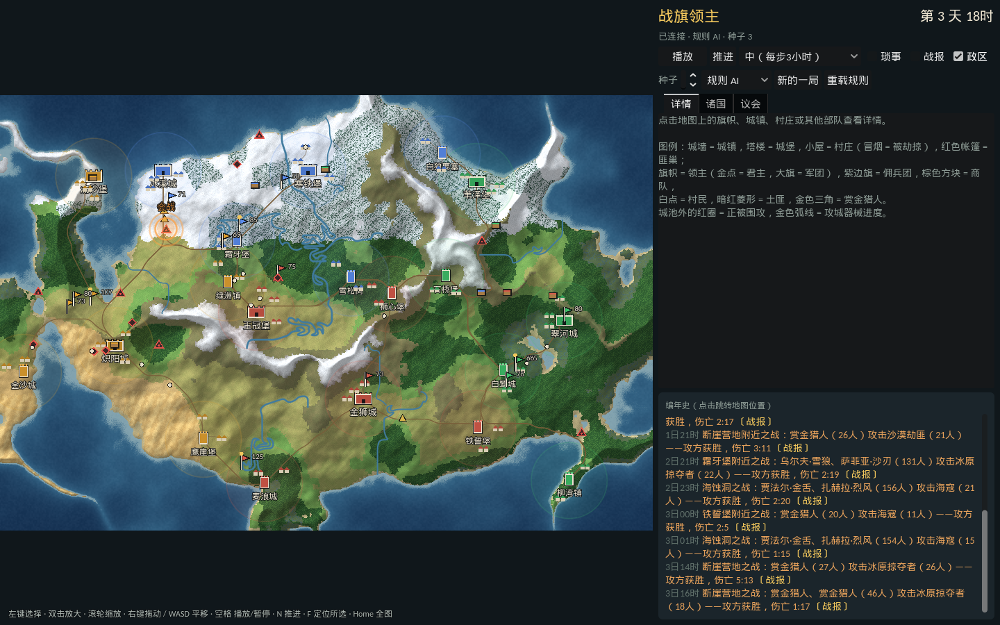

# 战旗领主 · Warlords（Godot 客户端 v2）

类骑砍战略层沙盒的可视化前端。所有规则与 AI 都在 Python 模拟服务器（`../server`），
本项目只负责显示与操作。




## 启动

```bash
./play.sh                    # 自动启动服务器（规则 AI）+ 客户端
BRAIN=openai ./play.sh       # OpenAI 领主（OPENAI_API_KEY）
BRAIN=deepseek ./play.sh     # DeepSeek 领主（DEEPSEEK_API_KEY）
BRAIN=claude ./play.sh       # Claude 领主（ANTHROPIC_API_KEY）
```
LLM 模式需先在 `../server` 目录执行 `uv venv && uv pip install -e '.[llm]'`。

## 操作

| 操作 | 说明 |
|---|---|
| 左键 / 双击 | 选择 / 放大到该处 |
| 滚轮 · 右键拖动 · WASD | 缩放 · 平移 |
| 空格 · N | 播放暂停 · 推进一步（速度选择每步 1/3/6/12 小时） |
| F · Home · Esc | 定位所选 · 全图 · 取消选择 |
| 详情 / 诸国 / 议会 | 所选对象详情（领主、部队、城镇市场、村庄、匪巢）/ 各国形势 / 议会提案、每位领主的投票与理由、君主裁决 |
| 编年史 | 点击条目跳转到地图位置；〔战报〕打开战报 |
| 战报 · 琐事 · 政区 | 大战自动弹出战报 · 显示命令/台词等 · 显示势力范围 |
| 重载规则 | 重新读取 `rules/balance.toml` 与 `rules/doctrine.toml`，不重开游戏 |

图例：城墙 = 城镇，塔楼 = 城堡，小屋 = 村庄（冒烟 = 被劫掠），红帐篷 = 匪巢；旗帜 = 领主（金点 = 君主，
「军团 N」= 军团），紫边旗 = 佣兵，棕色方块 = 商队，白点 = 村民，暗红菱形 = 土匪，金三角 = 赏金猎人；
城外红圈 = 围城，金色弧线 = 攻城器械进度。

## 结构

```
scripts/terrain.gdshader  地形着色器（高度 + 生态 → 海岸、山体光影、森林、沙丘、雪线、沼泽）
scripts/map_view.gd       相机、河流道路、据点与部队图标、移动插值、特效、台词气泡、悬停提示
scripts/main.gd           侧栏、编年史、命令行自动化
scripts/battle_report.gd  战报弹窗
scripts/api.gd            HTTP 客户端（/map /state /step /reset /reload）
```

## 自动化截图

```bash
godot --path . -- --speed=3 --steps=40 --report=last --capture=$PWD/docs/screens/x.png
godot --path . -- --zoom=640,520,3.2 --select=settlement:lion0 --capture=...
godot --headless --path . -- --steps=8 --capture=/dev/null      # 冒烟测试，输出 WARLORDS_OK
```

字体 Droid Sans Fallback（Apache 2.0，见 `assets/fonts/LICENSE.txt`）。（v1 的点线图版本不在本仓库中。）
